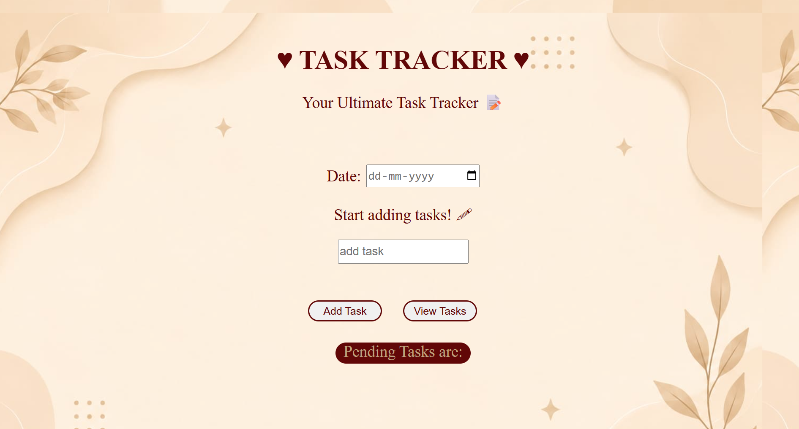
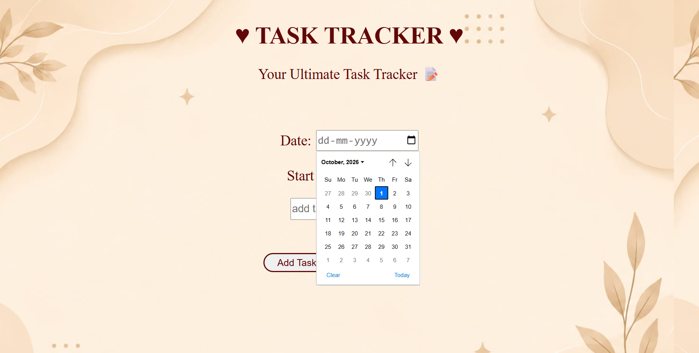
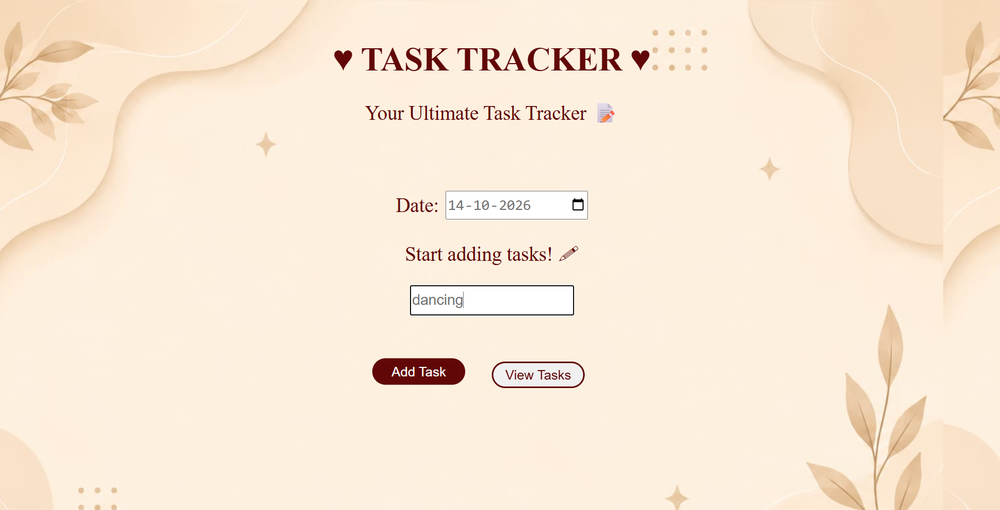
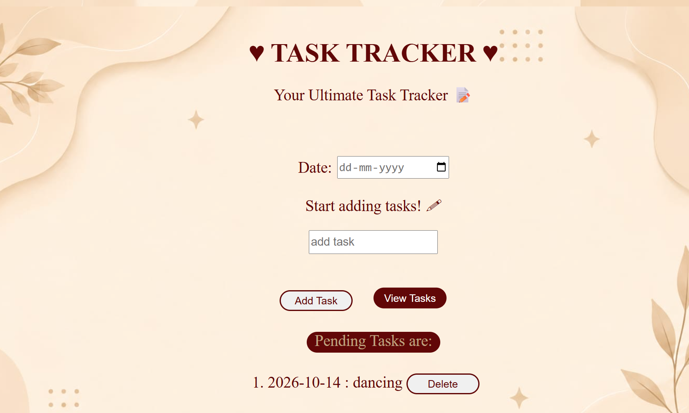
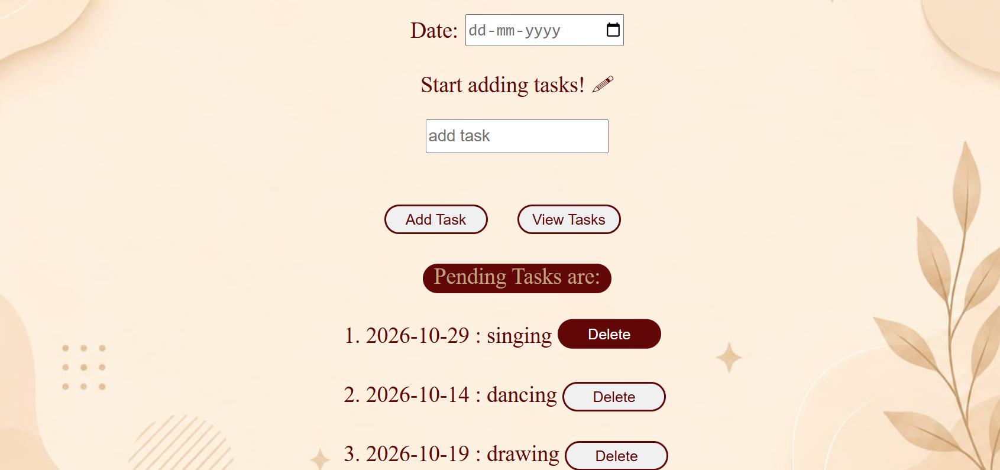
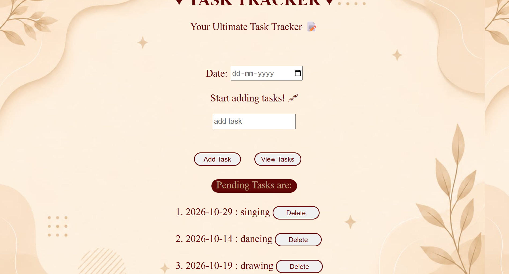

#  Task Tracker

A simple and interactive **Task Tracker** built using **HTML, CSS, and JavaScript**.

The application allows users to add tasks along with their dates, view their added tasks, and delete tasks when they are no longer needed.

##  Screenshots

###  Main Interface




###  Adding a Task




### Viewing a Task




###  Removing a Task






##  Features

- Add a task with a specific date
- Input validation for task and date
- Display a success message when a task is added
- View all added tasks
- Delete individual tasks
- Simple and clean user interface
- Responsive viewport configuration for different screen sizes
- Interactive button and input hover effects

##  Technologies Used

- **HTML5** - Structure of the application
- **CSS3** - Styling, layout, background, and hover effects
- **JavaScript** - Task management, validation, DOM manipulation, and event handling

##  Project Structure

```text
To-do-list-tracker/
│
├── todo.html
├── todo.css
├── todo.js
├── background.jpeg
├── README.md
│
└── screenshots/
    ├── home1.png
    ├── home2.png
    ├── task1.png
    └── task2.png
```

##  How to Run

1. Clone the repository:

```bash
git clone https://github.com/divyap-05/To-do-list-tracker.git
```

2. Open the project folder.
3. Open `todo.html` in a web browser.

No additional installation or dependencies are required.

##  How It Works

The application uses JavaScript to maintain the list of tasks during the current browser session.

When a user adds a task:

1. The task and date are read from the input fields.
2. The application checks whether both fields contain values.
3. The task is stored as an object inside a JavaScript array.
4. A success message is displayed.
5. The input fields are cleared.

When the user selects **View Tasks**, the stored tasks are displayed along with a **Delete** button for each task.

When the **Delete** button is clicked, the selected task is removed from the array and from the displayed task list.

##  Concepts Practiced

This project helped me practice:

- HTML forms and input elements
- CSS Flexbox
- CSS hover and transition effects
- JavaScript arrays and objects
- JavaScript functions
- Conditional statements
- Loops
- DOM manipulation
- `getElementById()`
- `createElement()`
- `appendChild()`
- Event handling
- Array methods such as `push()` and `splice()`
- Basic input validation

##  Future Improvements

Some possible improvements for future versions are:

- Add `localStorage` so tasks remain after refreshing the page
- Add task editing functionality
- Add task completion status
- Add task filtering by date or completion status
- Improve mobile responsiveness
- Add task categories or priorities
- Add a task counter
- Improve accessibility

##  Author

**Divya Pai**

Second-Year Engineering Student
